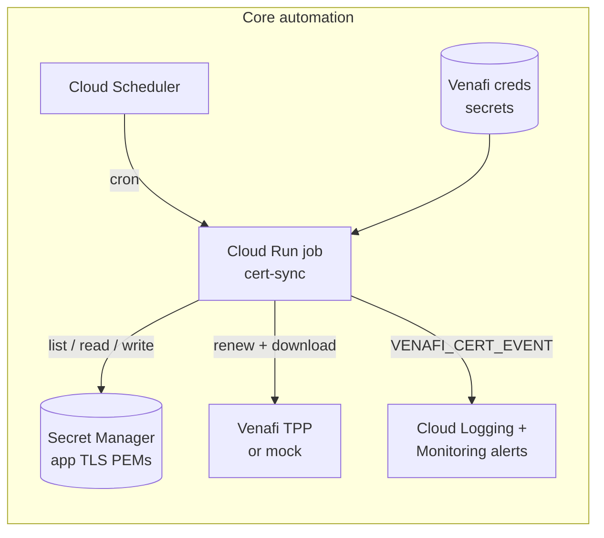
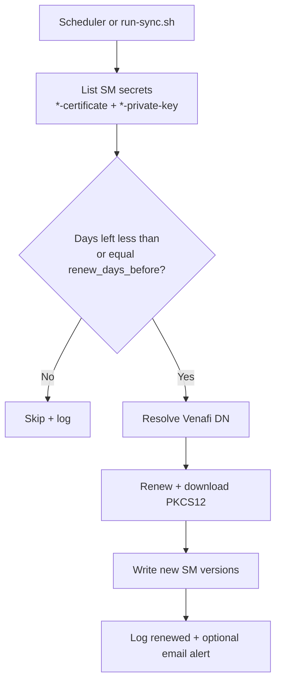

# Venafi Certificate Automation for Google Cloud

Automates renewal of TLS certificates from Venafi Trust Protection Platform (TPP) into Google Cloud Secret Manager, on a schedule, with Cloud Logging and optional email alerts.

The same sync job works with a **mock Venafi** API (dry-run / validation) or a **real Venafi TPP** endpoint (client / production). Switching modes does not require application code changes.

Optional HTTPS demos live under `examples/` and are not required for client deployments.

---

## Problem this solves

Teams that keep private certificates in Venafi often still renew and install them on Google Cloud by hand: check expiry, renew/export from Venafi, split cert/key, upload to Secret Manager, then update Certificate Manager or Terraform. That process is easy to miss and hard to audit.

This package closes the loop for **certificates already in Secret Manager**:

1. Scheduler (or operator) runs the sync job
2. Job discovers `*-certificate` / `*-private-key` pairs in the project
3. If a cert is due (or force renew), it renews from Venafi, downloads PKCS#12, validates key match
4. Writes new Secret Manager versions and emits structured logs (optional email on renew/failure)

Downstream consumers (LBs, apps, Certificate Manager) keep reading from Secret Manager. Re-applying those stacks (for example via a client Cloud Build trigger) is separate from the core renew job.

---

## What this solution can do

| Capability | Detail |
| --- | --- |
| Discover certs | Scans the GCP project Secret Manager for `*-certificate` + paired `*-private-key` (no deploy-time CN/DN inventory) |
| Renew on schedule | Cloud Scheduler runs the sync job on a configurable cron |
| Renew when due | Uses `renew_days_before` (default 30); optional force renew |
| Venafi integration | Real TPP authorize / renew / retrieve, or optional mock TPP |
| Secret Manager write | New PEM cert/key versions after a successful renew |
| Observability | Structured `VENAFI_CERT_EVENT` logs in Cloud Logging |
| Email alerts | GCP Monitoring log-based alerts on renew and/or failure |
| Portable config | Project, region, prefix, schedule, renew window via tfvars / env |
| Optional demos | `examples/` seed near-expiry certs and an HTTPS LB to show before/after |

Core does **not** invent application TLS secrets or create client load balancers. Those stay owned by the application / platform teams (or by optional examples for validation).

---

## Use cases

| Audience | How to use |
| --- | --- |
| Client / production | Deploy core only (`enable_mock=false`), point at real Venafi, let the job scan existing SM certs |
| Dry-run / validation | Deploy core with `enable_mock=true` when corporate Venafi is not reachable yet |
| Demo / training | Deploy core + `examples/app-https-lb` (and optionally edge) to show near-expiry then renew |
| Foundation / CI | Copy `terraform/` + `services/`, use GCS backend, apply without bash scripts |

---

## Mock vs real Venafi

**Important:** Moving from mock to real Venafi (or deploying real Venafi from day one) needs **config and credentials only**. There is **no application or job code change**. The same `cert-sync` image talks to either endpoint.

| Mode | When to use | What you set |
| --- | --- | --- |
| Mock | Corporate TPP not reachable yet; dry-run / validation | `enable_mock=true`, `seed_mock_secret_versions=true` |
| Real TPP | Client / production | `enable_mock=false`, real `venafi_base_url`, real SM credentials |

### Why mock exists

Corporate Venafi access is often not available up front. Reachability from Cloud Run, accounts, policy DNs, and export passwords usually need security / PKI approvals.

The optional **mock Venafi TPP API** simulates authorize / renew / retrieve so the Google Cloud path (job, scheduler, Secret Manager, logging, alerts) can be proven end to end first. Mock is optional; clients can ignore it and deploy against real TPP immediately.

### Deploy with real Venafi (recommended for clients)

```bash
# terraform/terraform.tfvars (or answer deploy prompts)
enable_mock               = false
seed_mock_secret_versions = false
venafi_platform           = "tpp"
venafi_base_url           = "https://venafi.example.com"
# alert_emails, scheduler_cron, renew_days_before as needed

./scripts/deploy.sh
# When prompted / after apply: store real username, password, p12 password
./scripts/set-venafi-secrets.sh
```

Non-interactive:

```bash
NONINTERACTIVE=true PROJECT_ID=your-project USE_MOCK=false \
  VENAFI_BASE_URL=https://venafi.example.com \
  ALERT_EMAILS="ops@example.com" \
  ./scripts/deploy.sh
./scripts/set-venafi-secrets.sh
```

Ensure application certs already exist in Secret Manager as `*-certificate` / `*-private-key` (or deploy an example only for demos). Optional annotation `venafi-dn` on the cert secret helps DN resolution.

### Switch from mock to real (no code change)

1. Set `enable_mock=false` and `seed_mock_secret_versions=false`
2. Set `venafi_base_url` to the real TPP URL
3. `terraform apply` (or re-run `./scripts/deploy.sh`)
4. `./scripts/set-venafi-secrets.sh` with real credentials
5. `./scripts/run-sync.sh` to verify

Same job image and same discovery logic; only the Venafi URL and secrets change.

---

## Repository layout

```
venafi-cert-automation/
├── README.md
├── .gitignore
├── cloudbuild/
│   └── build-images.yaml          # Builds/pushes cert-sync (+ mock-venafi) images
├── terraform/                     # CORE infrastructure (apply this for clients)
│   ├── apis.tf                    # Required GCP APIs
│   ├── artifact_registry.tf       # Docker repo for job images
│   ├── cloud_run_job.tf           # Sync job + env (discovery / renew knobs)
│   ├── scheduler.tf               # Cron that executes the job
│   ├── secrets.tf                 # Venafi credential secret shells (+ optional mock seed)
│   ├── iam.tf                     # Sync / scheduler / mock SAs and roles
│   ├── monitoring.tf              # Email channels + renew/failure alert policies
│   ├── mock_venafi.tf             # Optional mock TPP Cloud Run service
│   ├── pubsub.tf                  # Optional events topic (off by default)
│   ├── providers.tf / versions.tf
│   ├── variables.tf / outputs.tf
│   ├── backend.tf.example         # Optional GCS remote state for foundations
│   └── terraform.tfvars.example   # Documented knobs (copy to terraform.tfvars)
├── services/
│   ├── cert-sync/                 # Sync job image (discover -> renew -> SM)
│   │   ├── sync_cert.py           # Main loop
│   │   ├── discover.py            # Secret Manager discovery
│   │   ├── venafi_client.py       # TPP / mock API client
│   │   ├── secret_manager.py      # Read / write SM versions
│   │   ├── events.py              # Structured logging for Monitoring
│   │   ├── notify.py              # Optional Pub/Sub publish
│   │   └── Dockerfile
│   └── mock-venafi/               # Optional mock TPP (authorize/renew/retrieve)
├── scripts/
│   ├── deploy.sh                  # Deploy core (tfvars-first prompts)
│   ├── destroy.sh                 # Tear down core only
│   ├── run-sync.sh                # One-shot job execution
│   ├── set-venafi-secrets.sh      # Real Venafi credentials into SM
│   ├── README.md
│   └── internal/lib.sh            # Shared ask / tfvars helpers
└── examples/                      # OPTIONAL demos (not part of client core)
    ├── README.md
    ├── app-https-lb/              # Near-expiry app-tls seed + HTTPS LB + status page
    └── edge-https-lb/             # Same pattern for edge-tls (second cert)
```

---

## Architecture





---

## Logging and monitoring

The sync job writes normal Cloud Run logs to **Cloud Logging** (no custom log bucket).

On each cert outcome it also emits a structured event:

| Field | Meaning |
| --- | --- |
| `message` | Always `VENAFI_CERT_EVENT` |
| `status` | `renewed`, `uploaded`, `skipped`, `failed`, or `run_complete` |
| `cert_name` | Logical name (secret prefix) |
| `summary` | Human-readable one-liner |
| plus | `expiry`, `subject`, `secret_cert`, `secret_cert_version`, `error`, … |

**Email alerts** (optional) use GCP Monitoring:

- Notification channel(s) from `alert_emails` and/or `notification_channel_ids`
- Log-based alert on `status=renewed` (and optionally `status=failed`)
- Incident sample includes extracted fields (`cert_name`, `expiry`, `summary`, …)
- Verify email channels in the console after create (Google sends a confirm link)

```bash
gcloud logging read \
  'resource.type="cloud_run_job" AND resource.labels.job_name="venafi-cert-sync" AND jsonPayload.message="VENAFI_CERT_EVENT"' \
  --limit=40 --format=json
```

Pub/Sub is **not** required for renew or email. It stays off unless `enable_pubsub_events=true`.

---

## What gets deployed

### Core (`./scripts/deploy.sh` / `terraform/`)

| GCP resource | Default name (prefix `venafi-cert`) | Always? |
| --- | --- | --- |
| Enabled APIs | Run, Scheduler, Secret Manager, Cloud Build, Artifact Registry, IAM, Logging, Monitoring (+ Pub/Sub API only if events on) | Yes |
| Artifact Registry | `venafi-cert` | Yes |
| Container image | `cert-sync:latest` | Yes |
| Cloud Run **job** | `venafi-cert-sync` | Yes |
| Cloud Scheduler | `venafi-cert-daily` | Yes |
| Service accounts | `venafi-cert-sync`, `venafi-cert-sched` | Yes |
| Secret Manager | `venafi-cert-venafi-username`, `-password`, `-p12-password` | Yes |
| IAM | Sync SA = Secret Manager admin; scheduler runs job; Cloud Build pushes images | Yes |
| Monitoring email channel | From `alert_emails` | If emails set |
| Alert policy (renewed / failed) | Prefixed alert policies | If alerts + channels |
| Mock Cloud Run service | `venafi-cert-mock` | Only `enable_mock=true` |
| Mock secret versions | Seeds mock username/password/p12 | Only mock + `seed_mock_secret_versions` |
| Pub/Sub topic | `venafi-cert-events` | Only `enable_pubsub_events=true` (default **off**) |

Core does **not** create application TLS secrets, load balancers, or Certificate Manager certificates.

### Example app HTTPS LB (`examples/app-https-lb/`)

| GCP resource | Default name | Notes |
| --- | --- | --- |
| Secret Manager TLS pair | `app-tls-certificate`, `app-tls-private-key` | Near-expiry seed (outside Terraform) |
| GCS state bucket | `{project}-venafi-cert-app-tf` | TF state + CB source package |
| Artifact Registry | `venafi-cert-app` | Status app image |
| Cloud Run service | `venafi-cert-app-app` | Status page (cert baked at TF apply) |
| Certificate Manager | cert + map + entry | Loaded from SM at apply time |
| HTTPS load balancer | Global IP, URL map, HTTPS proxy, forwarding rule, NEG, backend | Public HTTPS |
| Cloud Build trigger | `venafi-cert-app-https-lb` | Manual **Run** to re-apply LB cert |

`examples/edge-https-lb/` is the same pattern for `edge-tls-*` / prefix `venafi-cert-edge`.


---

## Deploy

### Scripts

Values already set in env or `terraform/terraform.tfvars` are not prompted.

`./scripts/deploy.sh` enables APIs, applies Terraform once, builds/pushes images, then updates Cloud Run. Local state uses a per-`project_id` workspace. Requires `bash`, `gcloud`, `terraform`, and `python3`.

```bash
# Prefer editing terraform/terraform.tfvars first
./scripts/deploy.sh

# Dry-run with mock (optional)
NONINTERACTIVE=true PROJECT_ID=your-project USE_MOCK=true \
  ALERT_EMAILS="you@example.com" FORCE_IMAGE_BUILD=true \
  ./scripts/deploy.sh
```

For **real Venafi**, see [Mock vs real Venafi](#mock-vs-real-venafi) (config only; no code change).

Priority: env var > existing tfvars > prompt > default.

### Terraform only (foundation / GCS state)

Scripts are optional. Copy `terraform/` and `services/` into your foundation:

1. Copy `terraform/backend.tf.example` to `backend.tf` and set bucket/prefix
2. Copy `terraform.tfvars.example` to `terraform.tfvars` and fill values
3. `terraform init && terraform apply`
4. Build/push images and update the Cloud Run job (and mock service if enabled), or set `image_sync` / `image_mock` before apply
5. For real Venafi, populate `{prefix}-venafi-*` secret versions

---

## Configuration

See `terraform/terraform.tfvars.example`.

```hcl
scheduler_cron            = "0 6 * * *"
scheduler_timezone        = "UTC"
renew_days_before         = 30
enable_mock               = false
seed_mock_secret_versions = false
enable_pubsub_events      = false
alert_emails              = ["ops@example.com"]
```

| Variable | Meaning |
| --- | --- |
| `scheduler_cron` / `scheduler_timezone` | When the sync job runs |
| `renew_days_before` | Renew when days left is at or below this value |
| `enable_mock` | Deploy optional mock Venafi Cloud Run service |
| `seed_mock_secret_versions` | When mock is on, seed mock creds into Venafi secrets |
| `enable_pubsub_events` | Optional events topic (default `false`) |
| `alert_emails` | Monitoring notification emails |

Venafi DN resolution: secret annotation `venafi-dn`, then TPP CN lookup, then `venafi_dn_prefix\CN`.

---

## Day-2 operations

```bash
./scripts/run-sync.sh              # one scan/renew (optional force)
./scripts/set-venafi-secrets.sh    # rotate real Venafi credentials
./scripts/destroy.sh               # core (+ optional examples)
```

---

## Examples (optional)

```bash
cd examples/app-https-lb && ./scripts/deploy.sh
# from repo root
./scripts/run-sync.sh
# Cloud Build Triggers > venafi-cert-app-https-lb > Run
```

Near-expiry seed is automatic (`SEED_NEAR_EXPIRY=false` to skip). Status pages show the cert baked at Terraform apply, not live Secret Manager.

---

## Security notes

- Venafi passwords go only to Secret Manager (never commit real secrets in tfvars)
- Example near-expiry seeds are demo data; do not enable example stacks in production unless intended
- Prefer private egress from Cloud Run to corporate TPP in production

---

## Cleanup

```bash
./scripts/destroy.sh
# core only — examples are separate
```

```bash
examples/app-https-lb/scripts/destroy.sh
examples/edge-https-lb/scripts/destroy.sh
```

---

## Optional: remove mock Venafi from the package

**Not required.** Most teams leave mock in the repo and simply set `enable_mock=false` for clients. Use the steps below only if you want the mock code/paths gone entirely.

1. Delete `services/mock-venafi/` and `terraform/mock_venafi.tf`
2. Remove `enable_mock`, `seed_mock_secret_versions`, `mock_*`, `image_mock` from `terraform/variables.tf`
3. Remove mock SA / invoker IAM from `terraform/iam.tf`
4. Remove `venafi_*_mock` versions from `terraform/secrets.tf`
5. In `terraform/cloud_run_job.tf`, always use `var.venafi_base_url` / `var.venafi_platform`
6. Remove mock outputs and the mock image build from scripts / `cloudbuild/build-images.yaml`
7. Destroy any previously created mock Cloud Run service if it exists
