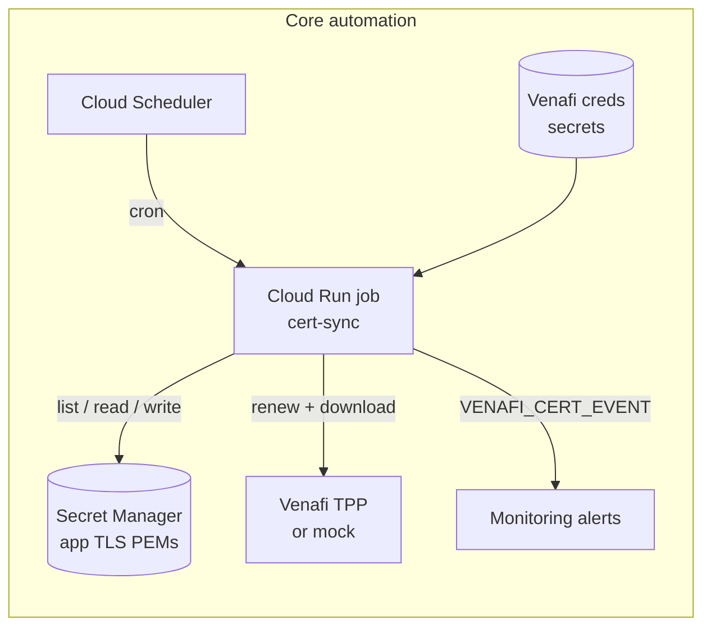
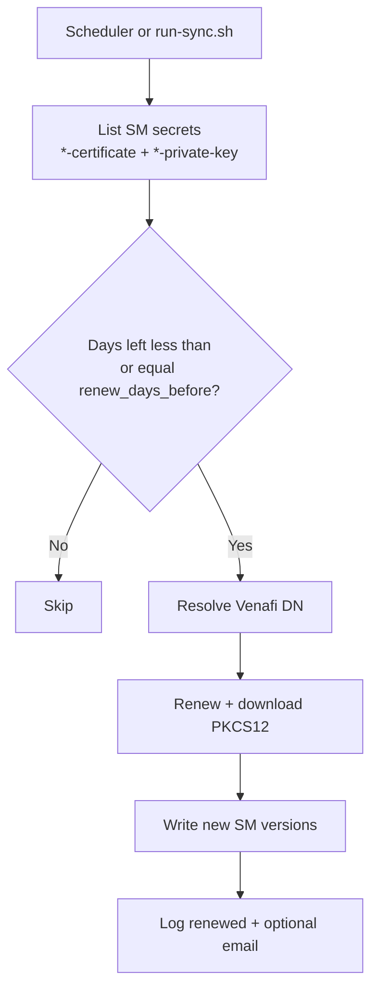
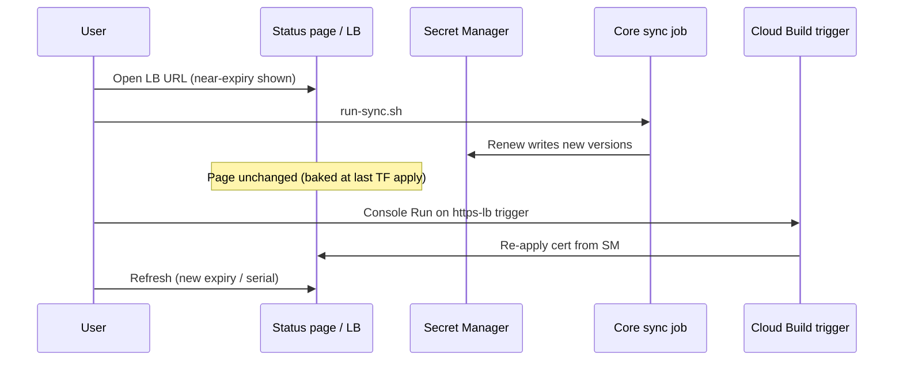

# Venafi Certificate Automation for Google Cloud

Scans Secret Manager in a GCP project for TLS certificates nearing expiry, renews them via Venafi Trust Protection Platform (TPP), and writes new versions back to those secrets.

No certificate inventory at deploy time. The sync job discovers `*-certificate` and paired `*-private-key` secrets already in the project.

Optional demos: `examples/`.

## Layout

```
venafi-cert-automation/
├── terraform/           # Job, scheduler, Venafi creds, alerts
├── services/cert-sync   # Discover, renew, write Secret Manager
├── services/mock-venafi # Optional mock TPP (enable_mock=true)
├── scripts/             # Optional deploy helpers
└── examples/            # Optional HTTPS LB demos
```

## Architecture





## What gets deployed

### Core (`./scripts/deploy.sh` / `terraform/`)

| GCP resource | Default name (prefix `venafi-cert`) | Always? |
| --- | --- | --- |
| Enabled APIs | Run, Scheduler, Secret Manager, Cloud Build, Artifact Registry, IAM, Logging, Monitoring (+ Pub/Sub API only if events on) | Yes |
| Artifact Registry | `venafi-cert` | Yes |
| Container image | `cert-sync:latest` | Yes |
| Cloud Run **job** | `venafi-cert-sync` | Yes |
| Cloud Scheduler | `venafi-cert-daily` | Yes |
| Service accounts | `venafi-cert-sync`, `venafi-cert-sched` | Yes |
| Secret Manager | `venafi-cert-venafi-username`, `-password`, `-p12-password` | Yes |
| IAM | Sync SA = Secret Manager admin; scheduler can run job; Cloud Build can push images | Yes |
| Monitoring email channel | From `alert_emails` | If emails set |
| Alert policy (renewed) | `venafi-cert certificate renewed` | If alerts + channels |
| Alert policy (failed) | `venafi-cert certificate sync failed` | If alerts + channels |
| Mock Cloud Run service | `venafi-cert-mock` + mock SA + public invoker | Only `enable_mock=true` |
| Mock secret versions | Seeds mock username/password/p12 | Only `enable_mock` + `seed_mock_secret_versions` |
| Pub/Sub topic | `venafi-cert-events` | Only `enable_pubsub_events=true` (default **off**) |

Core does **not** create application TLS secrets, load balancers, or Certificate Manager certificates.

### Example app HTTPS LB (`examples/app-https-lb/scripts/deploy.sh`)

| GCP resource | Default name | Notes |
| --- | --- | --- |
| Secret Manager TLS pair | `app-tls-certificate`, `app-tls-private-key` | Near-expiry seed (outside Terraform) |
| GCS state bucket | `{project}-venafi-cert-app-tf` | TF state + CB source package |
| Artifact Registry | `venafi-cert-app` | Status app image |
| Cloud Run service | `venafi-cert-app-app` | Status page (cert baked at TF apply) |
| Service account | `venafi-cert-app-app` | Status app identity |
| Certificate Manager | cert + map + entry | Loaded from SM at apply time |
| HTTPS load balancer | Global IP, URL map, HTTPS proxy, forwarding rule, NEG, backend | Public HTTPS |
| Pub/Sub topic | `venafi-cert-app-tf-apply` | Event source shape for CB trigger |
| Cloud Build trigger | `venafi-cert-app-https-lb` | Manual **Run** to re-apply LB cert |

### Example edge HTTPS LB (`examples/edge-https-lb/scripts/deploy.sh`)

Same pattern as app, with prefix `venafi-cert-edge` and secrets `edge-tls-certificate` / `edge-tls-private-key`.

### Renew demo flow (examples)



## Deploy

### Scripts

Values already set in env or `terraform/terraform.tfvars` are not prompted.

```bash
# Prefer editing terraform/terraform.tfvars first
./scripts/deploy.sh

NONINTERACTIVE=true PROJECT_ID=your-project USE_MOCK=true \
  ALERT_EMAILS="you@example.com" FORCE_IMAGE_BUILD=true \
  ./scripts/deploy.sh
```

Priority: env var > existing tfvars > prompt > default.

### Terraform only (foundation / GCS state)

Scripts are optional. Copy `terraform/` and `services/` into your foundation:

1. Copy `terraform/backend.tf.example` to `backend.tf` and set bucket/prefix.
2. Copy `terraform.tfvars.example` to `terraform.tfvars` and fill values.
3. Build and push images, or set `image_sync` / `image_mock`.
4. `terraform init && terraform apply`
5. For real Venafi, populate `{prefix}-venafi-*` secret versions (or `scripts/set-venafi-secrets.sh`).

## Configuration

See `terraform/terraform.tfvars.example`.

```hcl
scheduler_cron            = "0 6 * * *"
scheduler_timezone        = "UTC"
renew_days_before         = 30
enable_mock               = false
seed_mock_secret_versions = false
enable_pubsub_events      = false
alert_emails              = ["ops@example.com"]
```

| Variable | Meaning |
| --- | --- |
| `scheduler_cron` / `scheduler_timezone` | When the sync job runs |
| `renew_days_before` | Renew when days left is at or below this value |
| `enable_mock` | Deploy mock Venafi Cloud Run service |
| `seed_mock_secret_versions` | When mock is on, seed mock Venafi credentials into Secret Manager. Use `false` for real TPP |
| `enable_pubsub_events` | Create optional events topic (default `false`) |
| `alert_emails` | Monitoring notification emails |

Venafi DN resolution: secret annotation `venafi-dn`, then TPP CN lookup, then `venafi_dn_prefix\CN`.

## Pub/Sub

Default off. Renew and email alerts do not use Pub/Sub. Enable only if another system must subscribe to job result messages.

## Examples

```bash
cd examples/app-https-lb && ./scripts/deploy.sh
# from repo root
./scripts/run-sync.sh
# then Cloud Build Triggers > venafi-cert-app-https-lb > Run
```

Near-expiry seed is automatic (`SEED_NEAR_EXPIRY=false` to skip).

## Logging

```bash
./scripts/run-sync.sh

gcloud logging read \
  'resource.type="cloud_run_job" AND resource.labels.job_name="venafi-cert-sync"' \
  --limit=40 --format='value(textPayload)'
```

Renew events use `jsonPayload.message="VENAFI_CERT_EVENT"` and `status=renewed`.

## Remove mock Venafi

**Disable at runtime:** `enable_mock=false`, `seed_mock_secret_versions=false`, set real `venafi_base_url`, apply.

**Remove from the package:**

1. Delete `services/mock-venafi/` and `terraform/mock_venafi.tf`
2. Remove `enable_mock`, `seed_mock_secret_versions`, `mock_*`, `image_mock` from `terraform/variables.tf`
3. Remove mock SA / invoker IAM from `terraform/iam.tf`
4. Remove `venafi_*_mock` versions from `terraform/secrets.tf`
5. In `terraform/cloud_run_job.tf`, always use `var.venafi_base_url` / `var.venafi_platform`
6. Remove mock outputs and mock image build from scripts / `cloudbuild/build-images.yaml`
7. Destroy any previously created mock Cloud Run service

## Cleanup

```bash
./scripts/destroy.sh
# prompted to also destroy examples; or:
# DESTROY_EXAMPLES=true NONINTERACTIVE=true PROJECT_ID=... ./scripts/destroy.sh
```

Example-only:

```bash
examples/app-https-lb/scripts/destroy.sh
examples/edge-https-lb/scripts/destroy.sh
```

Or `terraform destroy` with the same backend and tfvars used to apply.
