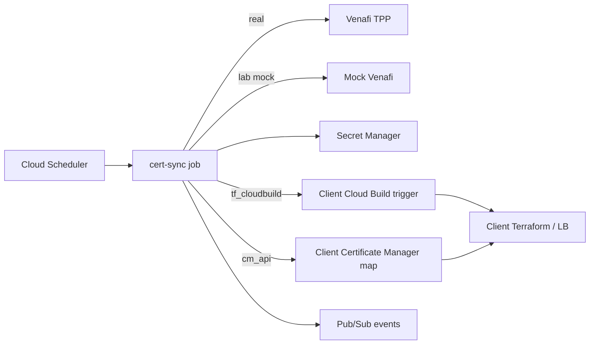

# Venafi Certificate Automation for Google Cloud

Automates renewal of TLS certificates from Venafi Trust Protection Platform (TPP) and installs the renewed material into Google Cloud (Secret Manager, then Certificate Manager and/or client Terraform).

Project ID, region, names, Venafi endpoints, and install targets are all configurable. The same sync job works with a **mock Venafi** API (lab / dry-run) or a **real Venafi TPP** endpoint (client / production). Switching modes does not require application code changes.

---

## Core vs lab (important)

| | **Core automation** | **Lab verification kit** |
| --- | --- | --- |
| Who uses it | Any client / project / environment that already has Venafi certs and edge infra | Teams validating the solution without corporate Venafi |
| What it does | Renew due/expired certs from Venafi, store in Secret Manager, install via CM API or a client-owned Terraform trigger | Same core, plus mock Venafi, **temporary expired seed certs**, and a temporary HTTPS status app / LB |
| Creates expired certs? | **No** | **Yes** (lab only, for renew demos) |
| Creates load balancer / app? | **No** (uses what the client already has) | **Yes** (`infra/lab-https-lb`) |
| Deploy | `./scripts/deploy.sh` → mode **1** | `./scripts/deploy.sh` → mode **2** |

Client environments should use **core only**. Lab mode is optional and must not be enabled where certificates and HTTPS infrastructure already exist.

Details: [scripts/lab/README.md](scripts/lab/README.md)

---

## Problem this solves

Teams that keep private certificates in Venafi often still renew and install them on Google Cloud by hand: check expiry, renew/export from Venafi, split cert/key, upload to Secret Manager, update Certificate Manager or Terraform. That process is easy to miss and hard to audit.

This package closes the loop for **existing** certificates:

1. Scheduler (or operator) runs the sync job
2. Job reads current Secret Manager cert; if due/expired (or force), renews from Venafi
3. Downloads PKCS#12, validates key match, writes new Secret Manager versions
4. Installs with exactly one configured method: Certificate Manager API, client Terraform via Cloud Build, or secrets-only

---

## Why we used a mock Venafi API

Corporate Venafi access is not always available up front. Getting URL reachability from Cloud Run, accounts, certificate policy DNs, and export passwords usually needs security / PKI approvals and is not a straight path for a first build.

The **mock Venafi TPP API** (lab mode) simulates authorize / renew / retrieve so the full Google Cloud path can be proven end to end. When corporate Venafi is ready, point the same job at the real base URL and store real credentials in Secret Manager. No application rewrite is required.

---

## Repository layout

```
venafi-cert-automation/
├── README.md
├── cloudbuild/
│   ├── build-images.yaml       # cert-sync, mock-venafi, cert-status-app images
│   └── lab-https-lb.yaml       # optional lab Cloud Build submit
├── infra/
│   ├── foundation/             # CORE: job, scheduler, secrets, mock (optional), IAM
│   └── lab-https-lb/           # LAB ONLY: status app + HTTPS LB + Certificate Manager
├── services/
│   ├── cert-sync/              # Sync job: Venafi -> Secret Manager -> install
│   ├── mock-venafi/            # Mock TPP API (lab / dry-run)
│   └── cert-status-app/        # Lab status page (serial, fingerprint, expiry)
└── scripts/
    ├── deploy.sh               # Mode 1 = core, mode 2 = core + lab
    ├── run-sync.sh
    ├── set-venafi-secrets.sh
    ├── destroy.sh
    ├── lab/README.md           # Lab-only notes
    └── internal/               # Helpers (do not run directly)
```

---

## Architecture (core)



---

## Quick start

### Client / production (core only)

```bash
./scripts/deploy.sh
# Deploy mode -> 1
# Use mock Venafi? -> n
# Provide Venafi URL + DN
# Install method -> 1 and your existing cert map names
#   or -> 2 and your existing Cloud Build trigger name
```

Non-interactive:

```bash
NONINTERACTIVE=true DEPLOY_MODE=core \
  PROJECT_ID=your-gcp-project \
  USE_MOCK=false \
  VENAFI_BASE_URL=https://venafi.example.com \
  VENAFI_CERTIFICATE_DN='\\VED\\Policy\\Apps\\app.example.com' \
  CERT_INSTALL_METHOD=cm_api \
  CERT_MAP_NAME=your-existing-map \
  CERT_MAP_ENTRY_NAME=your-existing-entry \
  ./scripts/deploy.sh
```

Core does **not** seed expired certificates and does **not** create a load balancer.

### Lab / validation (optional)

```bash
./scripts/deploy.sh
# Deploy mode -> 2
```

Lab seeds 1–2 expired certs, renews them via mock Venafi, then creates a temporary HTTPS status app so you can compare serial / fingerprint / expiry before and after.

---

## Day-2 operations

```bash
./scripts/run-sync.sh              # optional force renew
./scripts/set-venafi-secrets.sh    # rotate real Venafi credentials
./scripts/destroy.sh               # lab only, or everything
```

---

## How to see a renew (lab)

1. Open the lab URL from deploy (`https://LB_IP/` or `/api/cert`)
2. Note Serial, SHA-256, Not after, Secret version
3. `./scripts/run-sync.sh` with force renew = `y`
4. Refresh: those fields should change

---

## Test matrix

| # | Scenario | Mode | Expected |
| --- | --- | --- | --- |
| 1 | Client core deploy | 1 | Job + secrets + scheduler; no expired seeds; no lab LB |
| 2 | Lab first run | 2 | Expired seeds → sync renews → lab URL shows valid cert |
| 3 | Not due | either | `SKIPPED` when days left above threshold |
| 4 | Force renew | either | New serial / fingerprint / secret version |
| 5 | Real Venafi | 1 | Same job; credentials from Secret Manager only |
| 6 | Tear down | destroy | Lab only or full cleanup |

---

## Configuration reference

| Knob | Core default | Meaning |
| --- | --- | --- |
| `DEPLOY_MODE` / deploy prompt | `core` | `core` or `lab` |
| `enable_lab_stack` | `false` | Lab trigger / lab helpers |
| `seed_expired_certificates` | `false` | Must stay false for clients |
| `enable_mock` | `false` for clients | Mock TPP on Cloud Run |
| `cert_install_method` | `cm_api` | `cm_api` \| `tf_cloudbuild` \| `none` |
| `cert_map_name` / `cert_map_entry_name` | client values | Existing CM map (core + cm_api) |
| `external_tf_cloudbuild_trigger` | client value | Existing trigger (core + tf_cloudbuild) |

See `infra/foundation/terraform.tfvars.example`.

---

## Security notes

- Venafi passwords go only to Secret Manager (never committed tfvars)
- Lab expired seeding is intentional test data; keep it disabled in client projects
- Prefer private egress from Cloud Run to corporate TPP in production

---

## Cleanup

```bash
./scripts/destroy.sh
# y = core + lab
# n = lab verification stack only
```
