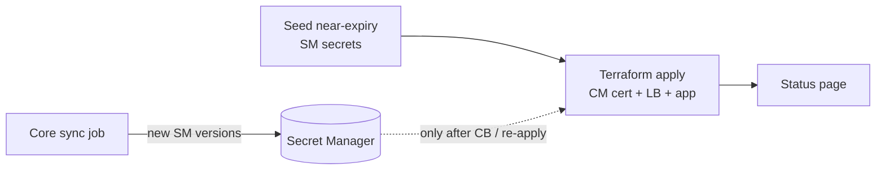

# Examples

Optional demos. Not required for client deployments.

| Example | Script | Default secrets | Default prefix |
| --- | --- | --- | --- |
| `app-https-lb/` | `./scripts/deploy.sh` | `app-tls-certificate` / `app-tls-private-key` | `venafi-cert-app` |
| `edge-https-lb/` | `./scripts/deploy.sh` | `edge-tls-certificate` / `edge-tls-private-key` | `venafi-cert-edge` |

Each example seeds near-expiry Secret Manager material and deploys an HTTPS LB + status page + Cloud Build trigger.

Status pages show the cert from the last Terraform apply, not live Secret Manager. After `./scripts/run-sync.sh`, run the Cloud Build trigger to refresh the LB and page.
